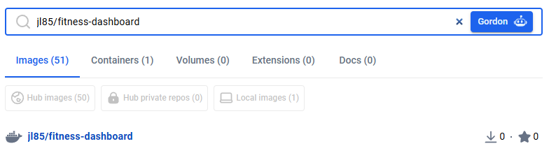
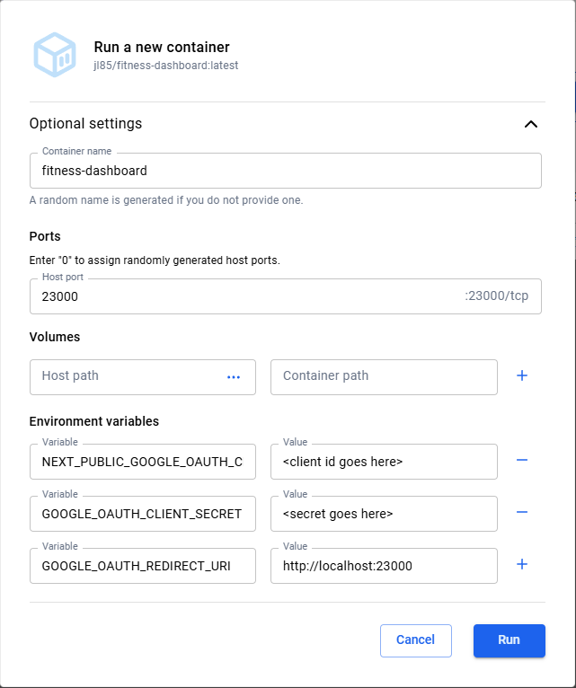

# Running the prebuilt Docker image

## Install Docker Desktop

Download Docker Desktop from https://www.docker.com/products/docker-desktop/

## Run the published image with Docker Desktop

In Docker Desktop, open **Images** and pull:

```
jl85/fitness-dashboard:latest
```

Pull the image in Docker Desktop. Create a Google OAuth client for a local web
application and add `http://localhost:23000` as an authorized JavaScript origin
and redirect URI.



Select the pulled image and choose **Run**. Expand the optional settings and
configure:

| Setting | Value |
| --- | --- |
| Port mapping | Host `23000` to container `23000` |
| `NEXT_PUBLIC_GOOGLE_OAUTH_CLIENT_ID` | Your Google OAuth client ID |
| `GOOGLE_OAUTH_CLIENT_SECRET` | Your Google OAuth client secret |
| `GOOGLE_OAUTH_REDIRECT_URI` | `http://localhost:23000` |

See the [main README](../../README.md) for the Google OAuth setup.



# Build and run a local image

For developers, you may want to build and run an image from source code:

Create a `.env.local` file with the Google OAuth values from the Google Cloud
Console:

```env
NODE_ENV=development
NEXT_PUBLIC_GOOGLE_OAUTH_CLIENT_ID=your-client-id
GOOGLE_OAUTH_CLIENT_SECRET=your-client-secret
GOOGLE_OAUTH_REDIRECT_URI=http://localhost:23000
```

Build the image from the repository root:

```bash
docker build -t dev-fitness-dashboard .
```

Then start it with Docker Desktop running:

```bash
docker run --env-file=.env.local -p 23000:23000 dev-fitness-dashboard
```
